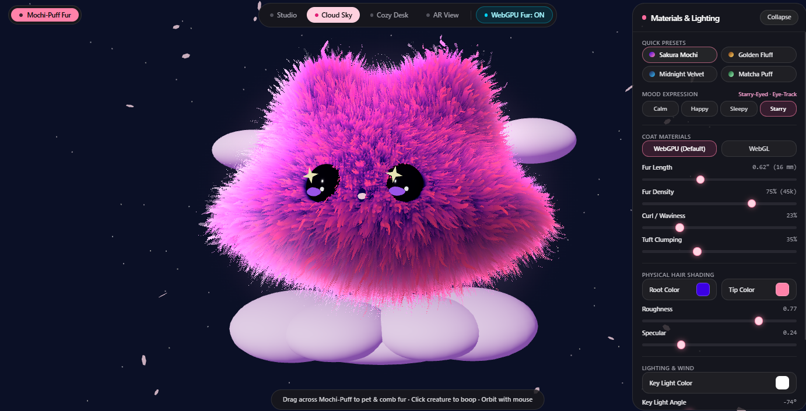
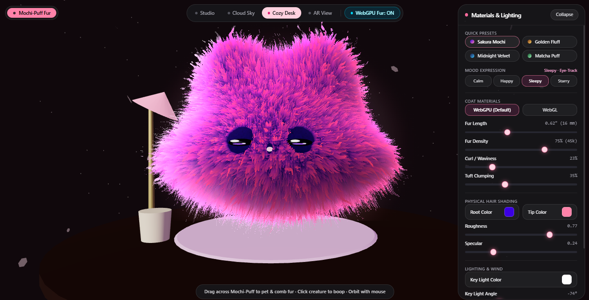
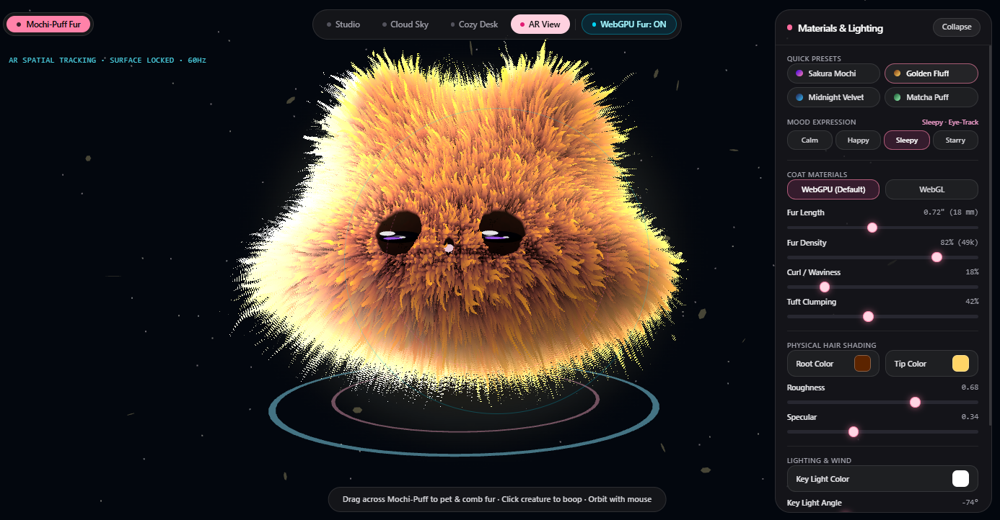
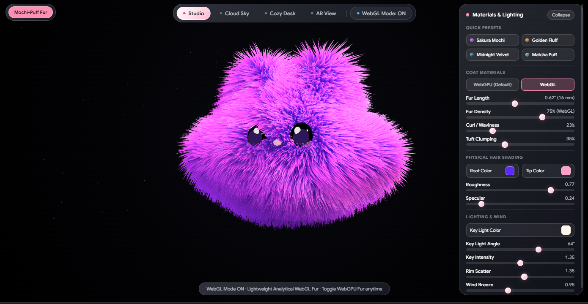

<div align="center">

# 🌸 Mochi-Puff Fur 3D

### Real-Time 40-Layer Volumetric Shell Fur Engine, Interactive 3D Creature & Anisotropic Hair Shader Studio

**Created by [Praveen Suthar](https://github.com/Praveen-Suthar-08)**

[](https://github.com/Praveen-Suthar-08/Mochi-Puff-3D-UI.git)
[](#)
[](#)
[](#)
[](#)
[](https://github.com/Praveen-Suthar-08)

<br />

<p align="center">
  <a href="https://github.com/Praveen-Suthar-08/Mochi-Puff-3D-UI.git">
    
  </a>
  <a href="https://github.com/Praveen-Suthar-08/Mochi-Puff-3D-UI/stargazers">
    
  </a>
  <a href="https://github.com/Praveen-Suthar-08/Mochi-Puff-3D-UI/network/members">
    
  </a>
</p>

<br />



<p align="center">
  <em>Interactive 40-layer volumetric shell fur with 3D cellular Voronoi tuft clumping, dual-lobe Kajiya-Kay iridescent hair shading, cursor-tracking anime eyes, and multi-stage 3D environments — engineered by <strong>Praveen Suthar</strong>.</em>
</p>

</div>

---

## 📖 Table of Contents

1. [Overview & Vision](#-1-overview--vision)
2. [Visual Showcase & Environment Gallery](#-2-visual-showcase--environment-gallery)
   - [Stage I: Cloud Sky & Starry-Eyed Mood](#21-cloud-sky-stage--sakura-mochi-coat--starry-eyed-mood)
   - [Stage II: Cozy Desk & Sleepy Mood](#22-cozy-desk-stage--sakura-mochi-coat--sleepy-mood)
   - [Stage III: AR Spatial View & Golden Fluff Coat](#23-ar-view-stage--golden-fluff-coat--sleepy-mood)
   - [Stage IV: Pitch-Black Velvet Studio](#24-studio-stage--pure-velvet-contrast)
3. [Core Graphics & Gameplay Features](#-3-core-graphics--gameplay-features)
4. [System Architecture & File Structure](#-4-system-architecture--file-structure)
5. [3D Creature Procedural Sculpting Pipeline](#-5-3d-creature-procedural-sculpting-pipeline)
6. [40-Layer Volumetric Shell Rendering Technique](#-6-40-layer-volumetric-shell-rendering-technique)
7. [WebGL2 GLSL Vertex & Fragment Shader Deep-Dive](#-7-webgl2-glsl-vertex--fragment-shader-deep-dive)
   - [7.1 Vertex Shader: Shell Extrusion, Gravity, Wind & Combing](#71-vertex-shader-shell-extrusion-gravity-wind--combing)
   - [7.2 Fragment Shader: 3D Cellular Tuft Field & Micro-Strand Jitter](#72-fragment-shader-3d-cellular-tuft-field--micro-strand-jitter)
   - [7.3 Dual-Lobe Kajiya-Kay Anisotropic Specular & Rim Scatter](#73-dual-lobe-kajiya-kay-anisotropic-specular--rim-scatter)
8. [Interactive Physics, Gaze Tracking & Mood Engine](#-8-interactive-physics-gaze-tracking--mood-engine)
   - [8.1 Damped Harmonic Oscillator ("Boop" Spring Physics)](#81-damped-harmonic-oscillator-boop-spring-physics)
   - [8.2 Raycast Fur Combing & Local Brush Displacement](#82-raycast-fur-combing--local-brush-displacement)
   - [8.3 Cursor Eye-Tracking, Natural Blinking & Mood State Machine](#83-cursor-eye-tracking-natural-blinking--mood-state-machine)
9. [3D Environment Stages & Instanced Particle Systems](#-9-3d-environment-stages--instanced-particle-systems)
10. [Materials, Presets & Lighting Parameter Reference](#-10-materials-presets--lighting-parameter-reference)
11. [Installation, Development & Unit Testing](#-11-installation-development--unit-testing)
12. [Performance Engineering & Hardware Adaptability](#-12-performance-engineering--hardware-adaptability)
13. [Author & Attribution](#-13-author--attribution)

---

## ✨ 1. Overview & Vision

**Mochi-Puff Fur** is an interactive, real-time 3D WebGL2 graphics showcase and tactile creature simulation created by **Praveen Suthar**. Designed to push browser-based volumetric fur rendering without relying on external gigabyte-scale hair caches or static texture maps, the entire rendering pipeline synthesizes **up to 60,000 procedural fur strands across 40 concentric shell layers** directly on the GPU.

Every strand of fur on Mochi-Puff responds dynamically to:
- **Direct Tactile Petting & Combing**: Drag across any part of Mochi-Puff's body to part, comb, and ruffle the fur in real time via 3D raycast surface-tangent vector fields.
- **Squish-and-Stretch "Boop" Physics**: Click or tap Mochi-Puff to trigger a volume-preserving damped harmonic spring oscillation accompanied by radial sparkle bursts and joyful ear wiggles.
- **Physical Hair Shading**: Customize root-to-tip dye gradients, macro-tuft clumping, strand curl/waviness, Kajiya-Kay anisotropic specular highlights, and Fresnel subsurface rim scatter.
- **Expressive Personality**: Mochi-Puff tracks your cursor with glossy obsidian-indigo anime eyes, blinks naturally at randomized intervals, blushes when petted, and transitions smoothly between **Calm**, **Happy**, **Sleepy**, and **Starry-Eyed** moods.

---

## 🖼️ 2. Visual Showcase & Environment Gallery

Below are real-time captures from the **Mochi-Puff Fur** engine across its interactive 3D environment stages, coat presets, and facial mood states.

### 2.1 Cloud Sky Stage · Sakura Mochi Coat · Starry-Eyed Mood

<div align="center">
  
</div>

| Parameter / System | Active Configuration | Technical Highlights |
| :--- | :--- | :--- |
| **Environment Stage** | `Cloud Sky` | Sculpted 3D twilight lavender cloud islands (`#F5D0FE` diffuse with `#3B0764` emissive bounce) floating in a deep midnight-indigo sky (`#0B1026`). |
| **Coat Preset** | `Sakura Mochi` | Deep electric-indigo roots (`#3B00E3`) transitioning through an orchid mid-tone into pastel sakura-pink tips (`#FF82A9`). |
| **Mood Expression** | `Starry-Eyed` (`Starry`) | Replaces the primary spherical catchlight with a custom 8-vertex rotating 4-point golden star geometry (`#FEF08A`), widened eye aperture (`1.10×`), and elevated rosy blush (`0.90`). |
| **Atmospheric FX** | Sakura Petals + Starlight | 28 instanced 3D sakura petals drifting on wind vectors alongside 120 tri-color starlight/firefly motes. |

---

### 2.2 Cozy Desk Stage · Sakura Mochi Coat · Sleepy Mood

<div align="center">
  
</div>

| Parameter / System | Active Configuration | Technical Highlights |
| :--- | :--- | :--- |
| **Environment Stage** | `Cozy Desk` | Warm walnut-wood circular tabletop (`#361E15`), soft pastel-pink woven coaster mat (`#FBCFE8`), miniature ceramic cup with matcha tea (`#4ADE80`), and a brass-stem pastel desk lamp casting warm emissive fill. |
| **Coat Preset** | `Sakura Mochi` | `0.62" (16 mm)` fur length, `75% (45k)` strand density, `23%` curl/waviness, and `35%` macro-tuft clumping. |
| **Mood Expression** | `Sleepy` | Relaxed half-closed eyelids (`eyeScaleY: 0.25`), slowed respiratory breathing cadence (`1.25 rad/s`), and gentle ear micro-motion (`0.01`). |
| **Lighting Rig** | Key Light at `-74°` | Key intensity `1.35` with `1.35` Rim Scatter producing a soft glowing pink halo along the lower fur tips where Mochi-Puff hovers above the desk mat. |

---

### 2.3 AR View Stage · Golden Fluff Coat · Sleepy Mood

<div align="center">
  
</div>

| Parameter / System | Active Configuration | Technical Highlights |
| :--- | :--- | :--- |
| **Environment Stage** | `AR View` | Activates the `AR SPATIAL TRACKING · SURFACE LOCKED · 60Hz` telemetry HUD, central optical reticle, and dual counter-rotating 3D holographic calibration rings (`#38BDF8` outer ring & `#FF82A9` inner ring). |
| **Coat Preset** | `Golden Fluff` | Rich roasted-amber roots (`#5C2400`) blending into warm sun-kissed golden tips (`#FFD466`), `0.72" (18 mm)` fur length, `82% (49k)` density, `18%` curl, and `42%` tuft clumping. |
| **Physical Shading** | High Specular Sheen | Lowered roughness (`0.68`) and boosted anisotropic specular (`0.34`) with `1.55` Rim Scatter for a luminous golden crown silhouette. |
| **Mood Expression** | `Sleepy` | Drowsy, content eye posture with real-time cursor eye-tracking still active. |

---

### 2.4 Studio Stage · Pure Velvet Contrast

<div align="center">
  
</div>

In **Studio** mode, the background locks to pure pitch black (`#000000`) with a subtle color-synced volumetric bloom sprite behind the creature, isolating every individual fur tuft and silhouette rim highlight for precision material look-development.

---

## 🎮 3. Core Graphics & Gameplay Features

- **40-Shell Volumetric Fur Architecture**: Instantiates 40 concentric, normal-extruded shell meshes sharing a single sculpted vertex buffer with per-layer `THREE.ShaderMaterial` uniforms (`u_layer` from `0.0` to `1.0`).
- **Seam-Free 3D Cellular Tuft Clumping**: Uses a 3D Worley/Voronoi cellular lattice in object space combined with a high-frequency micro-strand grid so fur tufts never exhibit UV seam artifacts at the poles or ears.
- **Dual-Lobe Kajiya-Kay + Marschner Iridescence**: Computes physically inspired tangent-aligned hair highlights (`sin(T, H)`) paired with a secondary view-dependent cyan/magenta iridescent lobe and Fresnel rim scatter.
- **Tactile Fur Combing & Petting**: Left-dragging across Mochi-Puff raycasts against an invisible proxy collider, projecting pointer velocity onto the local surface tangent plane to bend fur strands in the direction of your stroke.
- **Volume-Preserving Boop Physics**: Clicking Mochi-Puff injects kinetic energy into a second-order damped harmonic oscillator ($k = 180$, $c = 11$), squishing the Y-axis while bulging the X/Z axes to preserve volume.
- **Live Cursor Eye-Tracking & Natural Blinking**: Both multi-part anime eye rigs track normalized device coordinates (NDC) with damped spring interpolation and execute cosine-eased blinks every `3.2–5.6` seconds.
- **Four Expressive Mood States**: Instant switching between **Calm**, **Happy**, **Sleepy**, and **Starry-Eyed** expressions, dynamically altering eyelid aperture, catchlight geometry, cheek blush opacity, and ear-wiggle frequency.
- **Four 3D Environment Stages**: Switch seamlessly between **Studio**, **Cloud Sky**, **Cozy Desk**, and **AR View**, each with custom 3D stage props, lighting ambiance, and particle opacity profiles.
- **Zero-Allocation Instanced Particle Systems**: Renders 28 wind-driven 3D sakura petals, 120 ambient firefly/starlight motes, and a 32-particle radial halo burst pool using `THREE.InstancedMesh` and `THREE.Points`.

---

## 🏗️ 4. System Architecture & File Structure

The project is engineered so the entire interactive 3D WebGL2 application runs directly from `/index.html` while keeping pure mathematical, physics, preset, and mood state logic modularized and unit-tested in TypeScript under `/src`.

```text
mochi-puff-fur/
├── index.html                  # Self-contained production 3D WebGL2 app (HUD + Three.js + GLSL Shaders)
├── metadata.json               # Application metadata and capability declarations
├── package.json                # Dependencies (Three.js, Tailwind CSS v4, Vite, TypeScript, tsx)
├── tsconfig.json               # Strict ES2022 TypeScript configuration
├── vite.config.ts              # Vite bundler & Tailwind CSS plugin configuration
├── .gitignore                  # Comprehensive Git ignore rules preserving showcase assets
├── .env.example                # Environment variable template
├── README.md                   # Complete technical documentation & visual showcase
├── public/
│   └── assets/
│       └── aistudio/
│           ├── Screenshot_2026-10-22_171412_814f9943.png  # Cloud Sky + Starry-Eyed showcase
│           ├── Screenshot_2026-10-22_171433_a7ba350f.png  # Cozy Desk + Sleepy showcase
│           ├── Screenshot_2026-10-22_171447_d6d13423.png  # AR View + Golden Fluff showcase
│           └── image_514eba49.png                         # Studio Mode reference capture
└── src/
    ├── mochiMath.ts            # Pure math, presets, mood configs, spring physics & light vectors
    ├── mochiMath.test.ts       # Automated unit test suite (8/8 tests passing via node:test)
    ├── App.tsx                 # React entry wrapper
    ├── main.tsx                # Application bootstrap
    └── index.css               # Global Tailwind CSS stylesheet
```

### Architectural Data Flow

```text
┌────────────────────────────────────────────────────────────────────────────┐
│                        USER INPUT & HUD CONTROLS                           │
│  • Pointer Drag / Click (Raycast Petting, Combing, Boop Impulse, Orbit)    │
│  • Environment Stage Pills (Studio | Cloud Sky | Cozy Desk | AR View)      │
│  • Sidebar Presets, Mood Selector, Coat Mode, 10 Sliders & 3 Color Pickers │
└─────────────────────────────────────┬──────────────────────────────────────┘
                                      │
                                      ▼
┌────────────────────────────────────────────────────────────────────────────┐
│                     SHARED SIMULATION & UNIFORM STATE                      │
│  • sharedState (furLength, furDensity, curl, clumping, root/tip colors)    │
│  • boopSpring (2nd-order damped harmonic oscillator: displacement, vel)    │
│  • combForce & brushPos/brushVel (exponentially decaying surface vectors)  │
│  • currentGazeOffset & blinkTimer (cursor NDC tracking & eyelid scaling)   │
└───────────────┬──────────────────────────────────────────┬─────────────────┘
                │                                          │
                ▼                                          ▼
┌──────────────────────────────────────┐  ┌──────────────────────────────────┐
│   40-LAYER SHELL SHADER PIPELINE     │  │   SCENE RIG & INSTANCED FX       │
│  • Vertex Shader:                    │  │  • Sculpted Mochi Rig + Eyes     │
│    - Normal extrusion (u_layer)      │  │  • Dynamic Canvas2D Bloom Halo   │
│    - Eye/Nose socket masking         │  │  • Stage Props (Clouds/Desk/AR)  │
│    - Gravity + Wind + Ear Wiggle     │  │  • InstancedMesh Sakura Petals   │
│    - Local/Global Combing bend       │  │  • Radial Boop Sparkle Pool      │
│  • Fragment Shader:                  │  │  • 120 Firefly/Starlight Motes   │
│    - 3D Cellular Voronoi Tuft Field  │  └──────────────────────────────────┘
│    - Micro-strand alpha discard      │
│    - Dual-lobe Kajiya-Kay + Fresnel  │
└──────────────────────────────────────┘
```

---

## 🧬 5. 3D Creature Procedural Sculpting Pipeline

Rather than loading an external `.glb` or `.obj` mesh, Mochi-Puff's organic silhouette is sculpted procedurally at startup in `createMochiBodyGeometry()` by deforming a high-resolution `THREE.SphereGeometry(1.56, 112, 84)`:

1. **Chubby Mochi Cheek Band**:
   A Gaussian bell curve centered slightly below the equator ($y_0 = -0.14$, $\sigma = 0.44$) expands horizontal and depth radii to create Mochi-Puff's signature plush, pear-shaped lower cheeks:
   $$B_{\text{cheek}}(y) = \exp\left(-\left(\frac{\hat{y} + 0.14}{0.44}\right)^2\right)$$
   $$x' = x \cdot (1.0 + 0.36 \cdot B_{\text{cheek}}), \quad z' = z \cdot (1.0 + 0.16 \cdot B_{\text{cheek}}), \quad y' = 0.88 \cdot y$$

2. **Soft Flattened Mochi Base**:
   For vertices where $\hat{y} < -0.42$, a smooth power curve lifts the bottom hemisphere upward so the creature rests naturally on flat surfaces like the **Cozy Desk** mat or **Cloud Sky** islands:
   $$\Delta y_{\text{base}} = 0.28 \cdot \left(\frac{-\hat{y} - 0.42}{0.58}\right)^{1.45}$$

3. **Twin Ear Tuft Lobes & Central Crown Dip**:
   Two normalized directional attractors ($\vec{d}_L = \text{norm}(-0.48, 0.85, 0.06)$ and $\vec{d}_R = \text{norm}(0.48, 0.85, 0.06)$) extrude the upper-left and upper-right crown into twin cat/bunny-like ear mounds, while a central attractor ($\vec{d}_C = \text{norm}(0, 1.0, 0.05)$) carves a gentle saddle dip between the ears:
   $$E_L = 0.68 \cdot \max(0, \hat{p} \cdot \vec{d}_L)^{8.5}, \quad E_R = 0.68 \cdot \max(0, \hat{p} \cdot \vec{d}_R)^{8.5}$$

4. **Normal Recomputation**:
   After all vertex positions are sculpted, `geo.computeVertexNormals()` recalculates smooth analytical vertex normals so the 40 fur shells extrude orthogonally from the sculpted surface.

---

## 💈 6. 40-Layer Volumetric Shell Rendering Technique

Real-time volumetric fur is achieved via the **Layered Shell Technique** (pioneered by Kajiya & Kay and Lengyel et al., modernized here for WebGL2 with 3D procedural cellular fields):

```text
Outer Tips (Layer 39, u_layer = 1.00)   .  *  .  *  .  *  .   <-- High wind sway, narrow tuft tips, bright rim glow
Upper Mid  (Layer 26, u_layer = 0.66)   |  |  |  |  |  |  |   <-- Tuft convergence pull toward Voronoi cell centers
Lower Mid  (Layer 13, u_layer = 0.33)  || || || || || || ||   <-- Orchid mid-color transition & curl wave distortion
Skin Base  (Layer 00, u_layer = 0.00) ███████████████████████ <-- Solid root coat (#3B00E3), deep ambient occlusion
```

- **40 Concentric Shell Meshes**: A loop instantiates `SHELL_COUNT = 40` meshes sharing `baseBodyGeometry`. Each shell receives a normalized uniform `u_layer = i / 39.0` and explicit `shellMesh.renderOrder = i` to guarantee deterministic inner-to-outer draw ordering.
- **Socket Attenuation Masking (`vEyeMask`)**: Around the left eye `(-0.42, 0.13, 1.58)`, right eye `(0.42, 0.13, 1.58)`, and button nose `(0.0, 0.02, 1.68)`, the vertex shader computes smooth Euclidean distance masks (`smoothstep(0.18, 0.39, dEye)`). Fur length is shortened inside these sockets and outer shell fragments with `vEyeMask < 0.18` are discarded so the glossy anime eyes and pastel nose never get buried by long fur.

---

## 🎛️ 7. WebGL2 GLSL Vertex & Fragment Shader Deep-Dive

### 7.1 Vertex Shader: Shell Extrusion, Gravity, Wind & Combing

Each vertex on shell layer $L \in [0, 1]$ undergoes five sequential physical transformations in `furVertexShader`:

1. **Mood-Driven Ear Wiggle**:
   Vertices in the upper ear mounds (`position.y > 0.75` and `|position.x| > 0.15`) oscillate harmonically with `u_earWiggle`, which scales up when Mochi-Puff is in **Happy** or **Starry** mood or actively being petted.
2. **Normal Shell Extrusion**:
   $$\vec{p}_{\text{shell}} = \vec{p}_{\text{base}} + \hat{n} \cdot (L \cdot \ell_{\text{local}})$$
3. **Anatomical Gravity & Ear Flare**:
   Body and cheek fur droops gently downward with $\vec{g}_{\text{body}} = (0.18 \hat{n}_x, -0.36, 0.12 \hat{n}_z) \cdot L^{1.55}$, whereas crown/ear fur flares upward and outward with $\vec{g}_{\text{ear}} = (0.34 \hat{n}_x, 0.26, 0) \cdot L^{1.55}$.
4. **Dynamic Wind Breeze (`u_windSpeed`)**:
   Driven by `u_time` and weighted by $L^2$ so hair roots remain anchored to the skin while tips sway in 3D space:
   $$\vec{W}(L, t) = u_{\text{windSpeed}} \cdot L^2 \cdot \ell_{\text{fur}} \cdot \begin{bmatrix} 0.16 \sin(\omega t + 2.3 y + 1.7 x) \\ 0.08 \cos(0.85 \omega t + 2.5 x) \\ 0.11 \sin(1.1 \omega t + 2.1 z) \end{bmatrix}$$
5. **Surface-Tangent Combing & Local Brush Bend**:
   Combines global combing momentum (`u_combForce`) with a Gaussian falloff around the active pointer contact point (`u_brushPos`), projecting the displacement onto the local tangent plane ($\vec{d}_{\perp} = \vec{d} - 0.65 (\vec{d} \cdot \hat{n})\hat{n}$) so combed fur lies flat along the body contour rather than poking into the mesh.

---

### 7.2 Fragment Shader: 3D Cellular Tuft Field & Micro-Strand Jitter

To avoid 2D UV stretching, `evaluateFurField()` operates entirely in 3D normalized object space (`vLocalPos`):

1. **Curl / Waviness Coordinate Distortion (`u_curl`)**:
   Displaces the 3D lookup coordinate with a tri-axial sinusoidal wave scaled by $L^{0.9}$ before sampling the fur field.
2. **Macro-Tuft 3D Voronoi / Worley Search (`u_clumping`)**:
   Evaluates a $3 \times 3 \times 3$ neighborhood in a 3D cellular grid of frequency `mix(10.0, 22.0, densityScale)` using a fast sin-free hash (`hash33`). As $L \to 1$, the sample point is pulled toward the nearest macro-clump center (`closestClumpCenter`) by `pow(L, 0.85) * (0.28 + u_clumping * 0.62)`, causing adjacent fibers to converge into pointed, plush fur tufts.
3. **Micro-Strand High-Frequency Grid**:
   Inside each macro-tuft, a secondary high-frequency 3D grid (`mix(34.0, 78.0, densityScale)`) generates individual hair fibers.
4. **Progressive Alpha-via-Discard**:
   Fragments whose local strand height falls below the layer threshold `pow(vLayer, 0.83) * (1.03 - densityNorm * 0.22)` execute `discard`, sculpting conical 3D hair tips with crisp depth buffering (`depthWrite: true`).

---

### 7.3 Dual-Lobe Kajiya-Kay Anisotropic Specular & Rim Scatter

Rather than flat Lambertian shading, the fragment shader implements a multi-component physical hair reflectance model:

- **Three-Stop Root-to-Tip Chromatic Gradient**:
  Blends `u_rootColor` ($L=0$) through an enriched electric-orchid mid-tone (`midColor`) into `u_tipColor` ($L=1$), modulated by per-tuft and per-fiber random albedo variation (`0.88` to `1.15`) and deep root ambient occlusion (`mix(0.22, 1.0, pow(vLayer, 0.56))`).
- **Wrapped Subsurface Diffuse**:
  Softens the terminator across the plush body:
  $$D_{\text{wrap}} = \text{clamp}\left(\frac{\hat{N} \cdot \hat{L} + 0.55}{1.55}, 0.0, 1.0\right)$$
- **Dual-Lobe Kajiya-Kay Anisotropic Specular**:
  Constructs the local hair tangent $\hat{T} = \text{normalize}(\hat{N} \times (0, 1, 0.1) + 0.35 \hat{N})$ and half-vector $\hat{H} = \text{normalize}(\hat{L} + \hat{V})$. Computes both a primary specular sheen and a tuft-shifted secondary Marschner iridescent lobe:
  $$\sin(\hat{T}, \hat{H}) = \sqrt{\max(0, 1 - (\hat{T} \cdot \hat{H})^2)}, \quad S_1 = \sin(\hat{T}, \hat{H})^{p} \cdot u_{\text{specular}} \cdot u_{\text{keyIntensity}}$$
- **Fresnel Subsurface Rim Scatter (`u_rimScatter`)**:
  Generates the luminous halo around Mochi-Puff's silhouette edges:
  $$R_{\text{rim}} = (1 - \max(0, \hat{N} \cdot \hat{V}))^{2.05} \cdot u_{\text{rimScatter}} \cdot (0.38 + 0.88 \cdot L^{0.48})$$

---

## 🐾 8. Interactive Physics, Gaze Tracking & Mood Engine

### 8.1 Damped Harmonic Oscillator ("Boop" Spring Physics)

Implemented in `stepBoopSpring()` (`src/mochiMath.ts` & `index.html`), clicking Mochi-Puff applies an instantaneous velocity impulse to a second-order spring system:

$$F = -k \cdot x - c \cdot v, \quad v_{t+\Delta t} = v_t + F \cdot \Delta t, \quad x_{t+\Delta t} = x_t + v_{t+\Delta t} \cdot \Delta t$$

With default stiffness $k = 180$ and damping $c = 11$, the displacement $x$ drives volume-preserving squash-and-stretch scale factors on `mochiRig`:

$$S_y = 1.0 - 0.28 \cdot x, \quad S_x = S_z = 1.0 + 0.16 \cdot x$$

### 8.2 Raycast Fur Combing & Local Brush Displacement

When the user drags across Mochi-Puff:
1. `THREE.Raycaster` intersects `hitProxyMesh` (a radius `2.05` bounding sphere attached to `mochiRig`).
2. The world hit point is transformed into Mochi-Puff's local space (`sharedState.brushPos`) and activates `u_brushActive = 1.0`.
3. Pointer drag deltas $(\Delta x, \Delta y)$ are blended into a bounded 3D combing vector via `updateCombVector()` with exponential momentum (`0.92` retention per move, clamped to `maxMagnitude = 1.15`).
4. When the pointer is released, `sharedState.combForce` decays smoothly at $0.985^{60 \Delta t}$ so combed fur gradually relaxes back into place.

### 8.3 Cursor Eye-Tracking, Natural Blinking & Mood State Machine

Each anime eye (`createAnimeEye()`) is a hierarchical 3D rig containing:
- **`eyeBall`**: Glossy obsidian-indigo sphere (`#0E061C`, `roughness: 0.06`, `metalness: 0.18`).
- **`gazeGroup`**: Tracks cursor NDC coordinates via `computeEyeGazeOffset(ndcX, ndcY, 0.055)` using frame-rate independent exponential damping (`1 - exp(-12 * dt)`):
  - **`mainHighlight`**: Upper-left primary white catchlight (`#FFFFFF`).
  - **`starMesh`**: Custom 8-vertex 4-point golden star geometry (`#FEF08A`) that rotates continuously when **Starry** mood is active.
  - **`subHighlight`**: Lower-right secondary specular dot.
  - **`irisGlow`**: Lower violet crescent glow (`#7C4DFF`).

| Mood ID | Display Label | Eye Scale $(X, Y)$ | Cheek Blush Opacity | Ear Wiggle Amp / Freq | Special Visual Behavior |
| :--- | :--- | :---: | :---: | :---: | :--- |
| **`calm`** | `Calm · Eye-Track` | `1.00 × 1.00` | `0.65` | `0.025` @ `2.2 Hz` | Classic glossy round catchlights & gentle breathing. |
| **`happy`** | `Happy · Eye-Track` | `1.06 × 0.96` | `0.95` | `0.095` @ `5.8 Hz` | Activates curved pastel smile arc (`happySmileArc`) below the nose & joyful ear wiggles. |
| **`sleepy`** | `Sleepy · Eye-Track` | `1.05 × 0.25` | `0.52` | `0.010` @ `1.1 Hz` | Drowsy half-lidded eyes & slowed respiratory rhythm (`1.25 rad/s`). |
| **`starry`** | `Starry-Eyed · Eye-Track` | `1.08 × 1.10` | `0.90` | `0.075` @ `4.8 Hz` | Swaps main catchlights for counter-rotating 4-point golden stars (`#FEF08A`). |

---

## 🌌 9. 3D Environment Stages & Instanced Particle Systems

### Four Interactive Environment Stages

1. **`Studio` (Default)**:
   Pure `#000000` background with an additive-blended dynamic `THREE.CanvasTexture` radial bloom sprite (`bloomSprite`) behind Mochi-Puff that automatically redraws its gradient stops whenever Root Color or Tip Color changes.
2. **`Cloud Sky`**:
   Transitions sky backdrop to twilight indigo (`#0B1026`) and reveals `stageCloudGroup`—seven sculpted 3D ellipsoid cloud puffs with soft lavender-pink shading and purple emissive bounce underneath Mochi-Puff and in the mid-ground sky.
3. **`Cozy Desk`**:
   Transitions backdrop to warm espresso (`#10080C`) and reveals `stageDeskGroup`—a 3D wooden tabletop (`CylinderGeometry`), a pastel woven coaster mat directly beneath Mochi-Puff, a ceramic mug filled with matcha tea on the left, and a brass-and-pink desk lamp arch casting warm light.
4. **`AR View`**:
   Transitions backdrop to deep cyber-slate (`#03070E`), reveals the spatial tracking HUD overlay (`AR SPATIAL TRACKING · SURFACE LOCKED · 60Hz`), and activates `stageArGroup` with concentric cyan (`#38BDF8`) and sakura-pink (`#FF82A9`) 3D calibration rings on the floor plane.

### Three Real-Time Particle Systems

- **Ambient Firefly & Starlight Motes (`THREE.Points`)**: 120 particles distributed across the 3D volume in a tri-color palette (sakura pink, warm firefly gold, and crisp starlight cyan-white).
- **Drifting 3D Sakura Petals (`THREE.InstancedMesh`)**: 28 hexagonal-oval 3D petals (`PETAL_COUNT = 28`) whose horizontal drift speed scales dynamically with the **Wind Breeze** slider (`0.35 + windSpeed * 0.85`) while tumbling across all three Euler axes.
- **Interactive Boop Halo Sparkles (`THREE.InstancedMesh`)**: A pre-allocated pool of 32 sphere sparkles (`BURST_MAX = 32`) that erupt in a radial halo ring (`radius 1.65–2.10`) around Mochi-Puff's silhouette whenever the creature is booped or petted.

---

## 🎨 10. Materials, Presets & Lighting Parameter Reference

### Built-In Quick Presets

| Preset Name | Root Color | Tip Color | Fur Length | Fur Density | Curl / Waviness | Tuft Clumping | Roughness | Specular | Rim Scatter |
| :--- | :---: | :---: | :---: | :---: | :---: | :---: | :---: | :---: | :---: |
| **Sakura Mochi** *(Default)* | `#3B00E3` | `#FF82A9` | `0.62" (16 mm)` | `75% (45k)` | `23%` | `35%` | `0.77` | `0.24` | `1.35` |
| **Golden Fluff** | `#5C2400` | `#FFD466` | `0.72" (18 mm)` | `82% (49k)` | `18%` | `42%` | `0.68` | `0.34` | `1.55` |
| **Midnight Velvet** | `#0A0E2E` | `#5CE1E6` | `0.54" (14 mm)` | `88% (53k)` | `12%` | `28%` | `0.62` | `0.42` | `1.75` |
| **Matcha Puff** | `#11381F` | `#98F5B4` | `0.66" (17 mm)` | `78% (47k)` | `30%` | `38%` | `0.74` | `0.26` | `1.40` |

### Real-Time Shader & Lighting Controls

| Control Group | Control Name | Range | Default | Uniform / Target | Description |
| :--- | :--- | :---: | :---: | :--- | :--- |
| **Coat Materials** | `WebGPU (Default)` / `WebGL` | Binary Toggle | `WebGPU` | `u_coatMode` | Toggles between iridescent multi-scatter WebGPU coat profile (`0.0`) and classic WebGL anisotropic coat (`1.0`). |
| **Fur Config** | **Fur Length** | `0.10"` – `1.50"` | `0.62" (16 mm)` | `u_furLength` | Controls normal extrusion distance across all 40 shell layers (displayed in inches & millimeters). |
| **Fur Config** | **Fur Density** | `10%` – `100%` | `75% (45k)` | `u_furDensity` | Scales 3D Voronoi macro-tuft and micro-strand grid frequencies (`6k` to `60k` virtual strands). |
| **Fur Config** | **Curl / Waviness** | `0%` – `100%` | `23%` | `u_curl` | Amplitude of 3D sinusoidal coordinate distortion along the hair shaft. |
| **Fur Config** | **Tuft Clumping** | `0%` – `100%` | `35%` | `u_clumping` | Strength of tip convergence pull toward 3D Voronoi cell centers. |
| **Hair Shading** | **Root Color** | Hex Color Picker | `#3B00E3` | `u_rootColor` | Base skin & lower hair shaft pigment; also updates the volumetric bloom halo. |
| **Hair Shading** | **Tip Color** | Hex Color Picker | `#FF82A9` | `u_tipColor` | Outer hair tip pigment, rim tint, sakura petal color, and boop burst color. |
| **Hair Shading** | **Roughness** | `0.00` – `1.00` | `0.77` | `u_roughness` | Controls Kajiya-Kay specular exponent (`mix(96.0, 14.0, roughness)`). |
| **Hair Shading** | **Specular** | `0.00` – `1.00` | `0.24` | `u_specular` | Intensity of primary and secondary anisotropic hair highlights. |
| **Lighting & Wind** | **Key Light Color** | Hex Color Picker | `#FFFFFF` | `u_keyLightColor` | Tint of the primary directional key light for both fur shaders and eye reflections. |
| **Lighting & Wind** | **Key Light Angle** | `-180°` – `180°` | `-74°` | `u_keyLightDir` | Orbits the directional key light horizontally around Mochi-Puff. |
| **Lighting & Wind** | **Key Intensity** | `0.00` – `3.00` | `1.35` | `u_keyIntensity` | Scales direct diffuse wrap and anisotropic specular brightness. |
| **Lighting & Wind** | **Rim Scatter** | `0.00` – `3.00` | `1.35` | `u_rimScatter` | Boosts Fresnel silhouette rim glow and background volumetric aura opacity. |
| **Lighting & Wind** | **Wind Breeze** | `0.00` – `2.00` | `0.95` | `u_windSpeed` | Controls tip breeze sway frequency/amplitude and sakura petal drift speed. |

---

## 🚀 11. Installation, Development & Unit Testing

### Prerequisites

- **Node.js** `>= 18.0.0` (or **Bun** `>= 1.0.0`)
- Modern browser with **WebGL2** support (Chrome, Edge, Firefox, Safari)

### Local Setup & Development Server

```bash
# 1. Clone the repository
git clone https://github.com/Praveen-Suthar-08/Mochi-Puff-3D-UI.git
cd Mochi-Puff-3D-UI

# 2. Install dependencies
npm install

# 3. Start the Vite development server on port 3000
npm run dev
```

Open `http://localhost:3000` in your browser to interact with **Mochi-Puff Fur**.

### Running Automated Unit Tests & Type Verification

All pure mathematical helpers, unit formatters, preset schemas, mood configurations, damped spring physics, and vector normalization routines in `src/mochiMath.ts` are verified with Node's native test runner:

```bash
# Run the unit test suite (9 tests)
./node_modules/.bin/tsx --test src/mochiMath.test.ts

# Run TypeScript type checking
npm run lint

# Build production bundle into /dist
npm run build
```

### Deploying to GitHub Pages (Automated via GitHub Actions)

This repository is pre-configured for **zero-config GitHub Pages deployment** using relative asset paths (`base: './'` in `vite.config.ts`) and an automated workflow in `.github/workflows/deploy.yml`:

1. Push this repository to GitHub (`main` or `master` branch).
2. In your GitHub repository, navigate to **Settings → Pages**.
3. Under **Build and deployment → Source**, select **GitHub Actions**.
4. Every push to `main` automatically runs `npm install` and `npm run build` and publishes the `./dist` bundle to `https://<your-username>.github.io/<repo-name>/`.

---

## ⚡ 12. Performance Engineering, HDR Post-Processing & Hardware Adaptability

- **Half-Float MSAA `EffectComposer` & `UnrealBloomPass`**: Uses a `THREE.HalfFloatType` multisampled `WebGLRenderTarget` (`samples: 4`) paired with `RenderPass` and `UnrealBloomPass` (`threshold: 0.78`). Outer fur tips (`vLayer > 0.45`) at grazing Fresnel angles (`fresnel > 0.35`) and iridescent Kajiya-Kay highlights selectively exceed the `0.78` luminance threshold, wrapping Mochi-Puff's silhouette in an optical glow whose `strength` and `radius` scale dynamically with the **Rim Scatter** slider and **WebGPU / WebGL** coat mode.
- **Single Shared Geometry Buffer**: All 40 fur shells reference the exact same `THREE.BufferGeometry` instance on the GPU, minimizing VBO memory footprint.
- **Zero-Texture Procedural Shading**: All tuft clumping, micro-fibers, color gradients, and Kajiya-Kay highlights are computed analytically in GLSL, eliminating texture fetch bandwidth bottlenecks.
- **Instanced Particle Rendering**: Both the 28 3D sakura petals and 32 boop burst sparkles use `THREE.InstancedMesh` so all particles render in a single draw call per system.
- **Automatic Hardware / Software WebGL Adaptation**: At initialization, an offscreen WebGL context probes `WEBGL_debug_renderer_info`. On dedicated GPUs, the engine runs at native retina resolution (`devicePixelRatio <= 2`) with `112 × 84` sphere segments and full-resolution `UnrealBloomPass`; in headless or software-rendered environments (`SwiftShader` / `llvmpipe`), it automatically scales the bloom buffer to `0.5×` and synchronizes frames via `gl.fenceSync`.

---

## 🕹️ 13. Interactive Mouse & Touch Controls Matrix

| Input Action | Target Area | Engine Response | Visual Feedback |
| :--- | :--- | :--- | :--- |
| **Left-Click / Tap** | On Mochi-Puff Creature | Calls `triggerBoop(0.95, hitPoint, true)` | Volume-preserving squash & stretch bounce, joyful ear wiggle spike, rosy cheek blush boost, and 18 radial halo sparkles. |
| **Left-Click + Drag** | Across Mochi-Puff Fur | Raycasts `hitProxyMesh` & updates `u_combForce` + `u_brushPos` | Parts and combs fur strands along the local surface tangent in the direction of your stroke; emits trailing micro-sparkles. |
| **Left-Click + Drag** | Background / Outside Creature | Updates `cameraOrbit.targetTheta` & `targetPhi` | Smoothly orbits the 3D perspective camera around Mochi-Puff (`theta` unrestricted, `phi` clamped to `[-0.75, 0.85]` rad). |
| **Right / Middle Drag** | Anywhere on Canvas | Updates `cameraOrbit.targetTheta` & `targetPhi` | Dedicated camera orbit override regardless of whether the cursor starts over the creature. |
| **Mouse Wheel / Pinch** | Anywhere on Canvas | Updates `cameraOrbit.targetRadius` | Smoothly dollies the camera in and out between `4.2` (macro fur inspection) and `9.5` (wide stage framing). |
| **Cursor Hover** | Anywhere in Window | Updates `pointerNDC` & `targetGazeOffset` | Both anime eyes track the cursor smoothly across the screen with a subtle curious head tilt (`mochiRig.rotation`). |

---

## 💻 14. Core GLSL Shader Reference (`evaluateFurField`)

For graphics engineers inspecting the procedural strand synthesis, below is the core 3D cellular Voronoi tuft + micro-fiber field evaluator used inside `furFragmentShader`:

```glsl
// 3D Sin-Free Hash for Cellular Voronoi Lattice
vec3 hash33(vec3 p3) {
  p3 = fract(p3 * vec3(0.1031, 0.1030, 0.0973));
  p3 += dot(p3, p3.yxz + 33.33);
  return fract((p3.xxy + p3.yxx) * p3.zyx);
}

// 3D Cellular Tuft + Strand Field (Zero UV Seams Across Entire Creature)
vec3 evaluateFurField(vec3 samplePos, float densityScale, float clumpAmount, float layer) {
  float clumpFreq = mix(10.0, 22.0, densityScale);
  vec3 clumpCoord = samplePos * clumpFreq;
  vec3 clumpCell = floor(clumpCoord);
  vec3 clumpFrac = fract(clumpCoord);

  float minClumpDist = 8.0;
  vec3 closestClumpCenter = vec3(0.0);
  float clumpId = 0.0;

  for (int x = -1; x <= 1; x++) {
    for (int y = -1; y <= 1; y++) {
      for (int z = -1; z <= 1; z++) {
        vec3 neighbor = vec3(float(x), float(y), float(z));
        vec3 rnd = hash33(clumpCell + neighbor);
        vec3 pt = neighbor + 0.15 + 0.70 * rnd;
        vec3 diff = pt - clumpFrac;
        float d = dot(diff, diff);
        if (d < minClumpDist) {
          minClumpDist = d;
          closestClumpCenter = (clumpCell + pt) / clumpFreq;
          clumpId = rnd.x;
        }
      }
    }
  }

  float clumpDist = sqrt(minClumpDist);

  // Pull samplePos toward the macro-clump center as layer increases (tuft convergence)
  float pull = pow(layer, 0.85) * (0.28 + clumpAmount * 0.62);
  vec3 pulledPos = mix(samplePos, closestClumpCenter, pull);

  // Micro-strand high-frequency grid inside each tuft
  float strandFreq = mix(34.0, 78.0, densityScale);
  vec3 strandCoord = pulledPos * strandFreq;
  vec3 strandCell = floor(strandCoord);
  vec3 strandFrac = fract(strandCoord) - 0.5;

  vec3 strandRnd = hash33(strandCell);
  vec2 jitter = (strandRnd.xy - 0.5) * 0.55;
  float strandDist = length(strandFrac.xy - jitter) * 1.72;

  float tuftCone = clamp(1.0 - clumpDist * (1.04 + clumpAmount * 0.45), 0.0, 1.0);
  float microFiber = clamp(1.0 - strandDist, 0.0, 1.0);

  float strandHeight = mix(
    tuftCone * (0.80 + 0.24 * clumpId),
    microFiber * (0.64 + 0.36 * strandRnd.z),
    0.46
  );

  return vec3(strandHeight, clumpId, strandRnd.y);
}
```

---

## 👨‍💻 15. Author & Attribution

<div align="center">

### **Created with 💖 by [Praveen Suthar](https://github.com/Praveen-Suthar-08)**

**Graphics Engineer & Frontend Architect**

*Designed and engineered from the ground up with Three.js, Custom WebGL2 GLSL Shaders, and Tailwind CSS.*

| Attribute | Details |
| :--- | :--- |
| **Creator & Lead Engineer** | **Praveen Suthar** |
| **GitHub Profile** | [@Praveen-Suthar-08](https://github.com/Praveen-Suthar-08) |
| **Project Repository** | [https://github.com/Praveen-Suthar-08/Mochi-Puff-3D-UI.git](https://github.com/Praveen-Suthar-08/Mochi-Puff-3D-UI.git) |
| **Project Title** | **Mochi-Puff Fur 3D** |
| **Rendering Architecture** | 40-Layer Volumetric Shell Fur · Dual-Lobe Kajiya-Kay Anisotropic Hair Shader |
| **Stack** | Three.js · WebGL2 GLSL · Tailwind CSS · TypeScript · Vite |
| **License** | MIT Open Source |

<br />

[](https://github.com/Praveen-Suthar-08)
[](https://github.com/Praveen-Suthar-08/Mochi-Puff-3D-UI)

</div>

---

## 📄 16. License & Acknowledgments

This project is open-source under the **MIT License**. You are welcome to use, study, and expand upon this shader and volumetric fur engine for personal, educational, or commercial 3D applications.

```text
MIT License

Copyright (c) 2026 Praveen Suthar

Permission is hereby granted, free of charge, to any person obtaining a copy
of this software and associated documentation files (the "Software"), to deal
in the Software without restriction, including without limitation the rights
to use, copy, modify, merge, publish, distribute, sublicense, and/or sell
copies of the Software, and to permit persons to whom the Software is
furnished to do so, subject to the following conditions:

The above copyright notice and this permission notice shall be included in all
copies or substantial portions of the Software.

THE SOFTWARE IS PROVIDED "AS IS", WITHOUT WARRANTY OF ANY KIND, EXPRESS OR
IMPLIED, INCLUDING BUT NOT LIMITED TO THE WARRANTIES OF MERCHANTABILITY,
FITNESS FOR A PARTICULAR PURPOSE AND NONINFRINGEMENT. IN NO EVENT SHALL THE
AUTHORS OR COPYRIGHT HOLDERS BE LIABLE FOR ANY CLAIM, DAMAGES OR OTHER
LIABILITY, WHETHER IN AN ACTION OF CONTRACT, TORT OR OTHERWISE, ARISING FROM,
OUT OF OR IN CONNECTION WITH THE SOFTWARE OR THE USE OR OTHER DEALINGS IN THE
SOFTWARE.
```

Special thanks to:
- **Kajiya & Kay (1989)** and **Lengyel et al. (2001)** for the seminal volumetric concentric shell extrusion techniques.
- **Mr.doob & the Three.js community** for an exceptional WebGL 3D foundation.
- The open-source community for making real-time WebGL graphics accessible to all.
